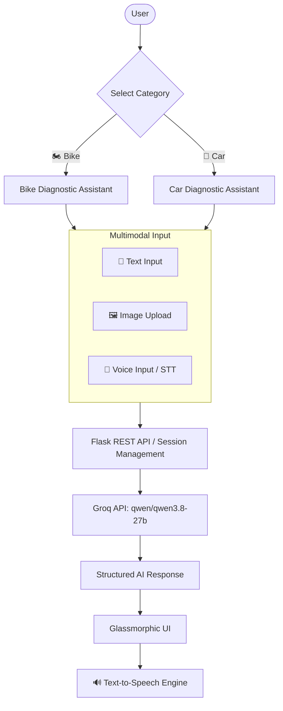

# AI MOTO: Intelligent AI Vehicle Assistant
**Project Documentation**

---

## 1. Project Title
**AI MOTO – Intelligent AI Vehicle Assistant**

## 2. Problem Statement
Vehicle owners (both bike and car owners) frequently encounter mechanical malfunctions, strange noises, starting issues, battery discharges, overheating, and maintenance uncertainties.

Beginner users often lack technical mechanical expertise and struggle to diagnose symptoms or understand component functions without searching across fragmented sources or visiting garages.

General-purpose chatbots do not offer specialized automotive mechanical troubleshooting workflows or beginner-friendly step-by-step diagnostic structures tailored to motorcycles and cars.

## 3. Proposed Solution
**AI MOTO** is a specialized, intelligent, multilingual AI vehicle assistant developed specifically for **Bikes 🏍️** and **Cars 🚗**.

Key architectural capabilities:
- **Vehicle Specialization**: Dedicated contexts for Bikes and Cars with tailored mechanical knowledge.
- **Multimodal Vision**: Image upload and analysis of vehicle components, wear, and visible damage via vision-capable AI models (`qwen/qwen3.8-27b`).
- **Multilingual Intelligence**: Full native fluency in **English** and **Tamil (தமிழ்)**.
- **Voice STT & TTS**: Speech-to-text input and natural text-to-speech reading with local accents.
- **Structured Diagnostics**: Standardized breakdown into Problem Summary, Possible Causes, Recommended Checks, and Suggested Action.
- **Vehicle Learning Mode**: Comprehensive modular explanations of automotive systems (Engine, Battery, Brakes, Transmission, Suspension, AC, etc.).
- **Domain Control**: Strict prevention of non-automotive queries.
- **Persistent Sessions & History**: 7-day secure sessions with conversation-level memory, search, and management.

## 4. Architecture & Workflow

## 5. Scope of the System
- **Bike Systems**: Engine (2T/4T), Disc/Drum Brakes, Wet Clutch, Chain & Sprockets, Carburetor/EFI, Telescopic Suspension, Electricals & Battery.
- **Car Systems**: Petrol/Diesel/EV Engines, Automatic/Manual Transmissions, Car AC, Radiator & Coolant, Disc Brakes & ABS/EBD, Struts & Multi-link Suspension, ECU & Sensors.
- **Learning Mode**: 1. What it is, 2. Why it is used, 3. How it works, 4. Common problems, 5. Basic maintenance.
- **Strictly Excluded Features**: PDF processing, Video/YouTube integration, Maps/Location services, Workshop/Showroom finders.

## 6. Technology Stack
- **Backend**: Python 3.10+, Flask, Flask-SQLAlchemy, Flask-Bcrypt, Flask-JWT-Extended
- **AI Processing**: Groq Cloud API (`qwen/qwen3.8-27b` for text & vision, `whisper-large-v3` for speech transcription)
- **Frontend**: HTML5, Vanilla Modern CSS (Dark/Light glassmorphism), Vanilla JavaScript, Marked.js, FontAwesome
- **Database**: SQLite / SQLAlchemy ORM
